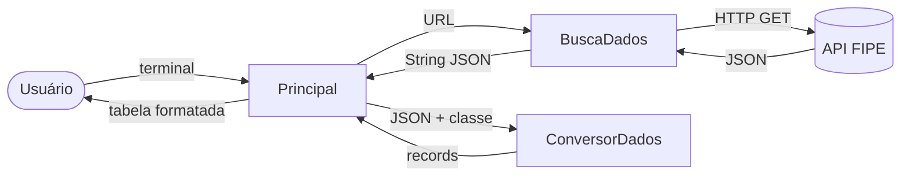

# 🚗 Feirão de Veículos — Consulta à Tabela FIPE

Aplicação de linha de comando em **Java 21 + Spring Boot** que consulta a **Tabela FIPE** em tempo real e mostra o valor de mercado de carros, motos e caminhões, ano a ano.

O usuário escolhe o tipo de veículo, a marca e o modelo (com busca por trecho do nome) e recebe a lista de preços de todos os anos disponíveis daquele modelo.


---

## 📸 Demonstração

```text
=== Tipos de veículo ===
  1. Carro
  2. Moto
  3. Caminhão
Escolha o tipo de veículo:
1

=== Marcas de Carro ===
       1 - Acura
       2 - Agrale
     ...
      21 - Fiat
     ...
Digite o código do(a) marca:
21
Digite um trecho do nome do modelo (ou Enter para listar todos):
mobi like

=== Modelos de Fiat ===
    7540 - MOBI LIKE 1.0 Fire Flex 5p.
    7541 - MOBI LIKE ON 1.0 Fire Flex 5p.
Digite o código do(a) modelo:
7540

=== Valores FIPE - MOBI LIKE 1.0 Fire Flex 5p. ===
  2026 | Flex       | R$ 66.621,00    | FIPE 001461-3 | outubro de 2026
  2025 | Flex       | R$ 60.934,00    | FIPE 001461-3 | outubro de 2026
  2024 | Flex       | R$ 55.696,00    | FIPE 001461-3 | outubro de 2026
  2023 | Flex       | R$ 52.741,00    | FIPE 001461-3 | outubro de 2026
  ...
```

> Os valores acima vêm de uma execução real; os preços mudam todo mês, conforme a FIPE atualiza a tabela.

---

## ✨ Funcionalidades

- **Três tipos de veículo**: carros, motos e caminhões.
- **Lista de marcas** em ordem alfabética, com o código de cada uma.
- **Busca de modelos por trecho do nome**, sem diferenciar maiúsculas de minúsculas (ou Enter para ver todos).
- **Valores de todos os anos do modelo**: ano, combustível, preço, código FIPE e mês de referência.
- **Validação da entrada**: opções e códigos inválidos são pedidos de novo, sem encerrar o programa.

---

## 🛠️ Tecnologias

| Tecnologia | Uso no projeto |
|---|---|
| **Java 21** | Linguagem: `record`, `enum`, Streams, `Optional`, `java.net.http.HttpClient` |
| **Spring Boot 4.1** | Ciclo de vida da aplicação, executada via `CommandLineRunner` |
| **Jackson 3** (`tools.jackson`) | Conversão de JSON em `record`s e listas genéricas |
| **JUnit 5 + Spring Boot Test** | Teste de carga do contexto |
| **Maven Wrapper** | Build sem precisar instalar o Maven |
| **[API FIPE (Parallelum)](https://deividfortuna.github.io/fipe/)** | Fonte pública dos dados da Tabela FIPE |

---

## 🚀 Como executar

### Pré-requisitos

- **JDK 21** ou superior
- Acesso à internet (a aplicação consulta a API FIPE a cada execução)

### Passo a passo

```bash
# 1. Clone o repositório
git clone https://github.com/brunocorreia-dev/feiraoveiculos.git
cd feiraoveiculos

# 2. Rode direto pelo Maven Wrapper
./mvnw spring-boot:run          # Linux/macOS
mvnw.cmd spring-boot:run        # Windows
```

Ou gere o `.jar` e execute:

```bash
./mvnw clean package
java -jar target/feiraoVeiculos-0.0.1-SNAPSHOT.jar
```

### Testes

```bash
./mvnw test
```

O teste sobe o contexto do Spring com `feirao.menu.ativo=false`, para que o menu interativo não fique esperando entrada no terminal e trave o build.

---

## 🧱 Arquitetura

```
src/main/java/com/brunocorreia/feiraoVeiculos
├── FeiraoVeiculosApplication.java   # Ponto de entrada (Spring Boot + CommandLineRunner)
├── principal/
│   └── Principal.java               # Fluxo do menu: leitura, busca e exibição
├── services/
│   ├── BuscaDados.java              # Requisições HTTP GET (java.net.http)
│   ├── IConversorDados.java         # Contrato de conversão JSON → objeto
│   └── ConversorDados.java          # Implementação com Jackson 3
└── model/
    ├── TipoVeiculo.java             # enum: CARRO, MOTO, CAMINHAO
    ├── Dados.java                   # record: código + nome (marcas, modelos, anos)
    ├── Modelos.java                 # record: envelope { "modelos": [...] }
    └── DadosVeiculos.java           # record: valor FIPE de um ano específico
```



Os detalhes de cada camada, o diagrama de sequência e as decisões de projeto estão em **[docs/ARQUITETURA.md](docs/ARQUITETURA.md)**. Os endpoints consumidos e o formato das respostas estão em **[docs/API-FIPE.md](docs/API-FIPE.md)**.

---

## 💡 O que este projeto exercita

- **Consumo de API REST** com o `HttpClient` nativo do Java, sem bibliotecas externas.
- **Desserialização genérica** com Jackson: um único conversor para objetos (`converteDados`) e para listas (`converteLista`), usando `CollectionType`.
- **Modelagem imutável com `record`s** e `@JsonAlias`, que mapeia os campos em PascalCase da API (`Valor`, `AnoModelo`…) para nomes idiomáticos em Java.
- **Streams** para filtrar, ordenar e transformar as listas.
- **Separação de responsabilidades**: interação com o usuário, acesso HTTP e conversão de dados ficam em classes separadas, e o conversor é exposto por uma interface.
- **Integração com o Spring Boot** via `CommandLineRunner`, com uma propriedade (`feirao.menu.ativo`) para desligar o menu nos testes.

---

## 🗺️ Próximos passos

- [ ] Exibir o ano `32000` como **"Zero KM"** (é a convenção da FIPE para veículos novos).
- [ ] Tratar falhas de rede e respostas de erro da API com mensagens amigáveis.
- [ ] Reaproveitar uma única instância de `HttpClient` e buscar os anos em paralelo.
- [ ] Transformar `BuscaDados`, `ConversorDados` e `Principal` em beans do Spring, com injeção de dependências.
- [ ] Testes unitários do conversor e do fluxo, com a API simulada (mock).
- [ ] Estatísticas do modelo: valor médio, mais barato e mais caro.

---

## 👤 Autor

**Bruno Correia** — [github.com/brunocorreia-dev](https://github.com/brunocorreia-dev)

Os dados vêm da API pública [Parallelum FIPE](https://deividfortuna.github.io/fipe/). Os valores servem apenas como referência; a fonte oficial é a [Fundação Instituto de Pesquisas Econômicas (FIPE)](https://veiculos.fipe.org.br/).
