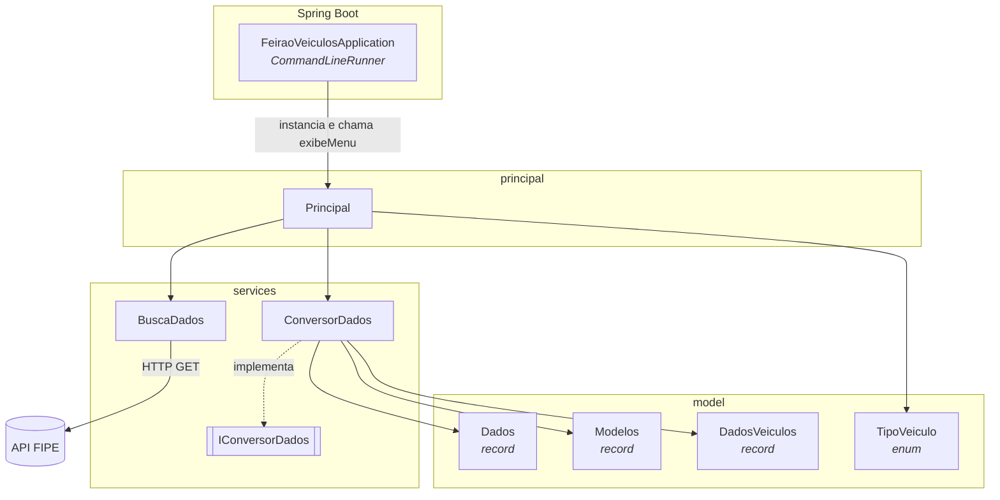
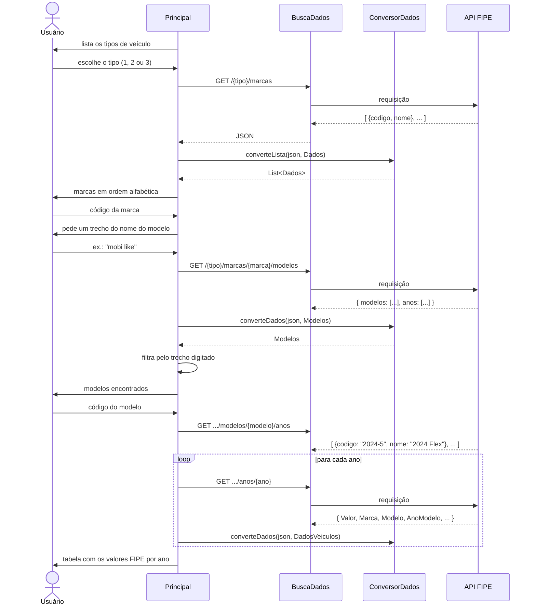

# Arquitetura

Este documento descreve como o **Feirão de Veículos** está organizado, como os dados percorrem a aplicação e por que algumas decisões foram tomadas.

← [Voltar ao README](../README.md)

---

## Visão geral

A aplicação é um programa de console. O Spring Boot gerencia o ciclo de vida e, assim que o contexto sobe, entrega o controle a um menu interativo (`Principal`). O menu conversa com o usuário pelo terminal e com a API FIPE pela rede.



---

## Camadas e responsabilidades

### `FeiraoVeiculosApplication` — ponto de entrada

- Anotada com `@SpringBootApplication` e implementa `CommandLineRunner`.
- No método `run`, cria um `Principal` e chama `exibeMenu()`.
- Lê a propriedade `feirao.menu.ativo` (padrão `true`). Quando ela é `false`, o menu não é executado. Os testes usam isso para subir o contexto sem ficar esperando entrada do teclado.

### `principal.Principal` — fluxo da aplicação

Orquestra a interação. Os métodos privados ficam agrupados por responsabilidade:

| Grupo | Métodos | O que faz |
|---|---|---|
| Fluxo | `exibeMenu()` | Executa o fluxo completo: tipo → marca → modelo → valores |
| Busca de dados | `buscarLista`, `buscarModelos`, `buscarVeiculos` | Monta a URL, chama `BuscaDados` e converte o JSON |
| Leitura do usuário | `lerTipoVeiculo`, `escolherOpcao`, `filtrarPorNome` | Lê o terminal, valida e repete até receber uma entrada válida |
| Exibição | `exibirOpcoes`, `exibirVeiculos`, `exibirTitulo` | Formata as listas e a tabela final com `printf` |

A URL base fica em uma constante (`ENDERECO = "https://parallelum.com.br/fipe/api/v1/"`). As URLs seguintes são montadas a partir da anterior (`enderecoMarcas` → `enderecoModelos` → `enderecoAnos`), seguindo a hierarquia da própria API.

### `services.BuscaDados` — acesso HTTP

- Usa o `java.net.http.HttpClient` nativo (Java 11+), sem dependências extras.
- Faz um `GET` na URL recebida e devolve o corpo da resposta como `String`.
- `IOException` e `InterruptedException` são relançadas como `RuntimeException`.

### `services.IConversorDados` / `ConversorDados` — conversão JSON

A interface define dois métodos genéricos:

```java
<T> T converteDados(String json, Class<T> classe);        // um objeto
<T> List<T> converteLista(String json, Class<T> classe);  // uma lista de objetos
```

`ConversorDados` implementa os dois com o `ObjectMapper` do **Jackson 3** (pacote `tools.jackson`). Para listas, monta um `CollectionType` (`List<classe>`), porque o *type erasure* do Java impede passar `List<Dados>.class` diretamente.

Com a interface, o resto do código fica independente do Jackson: dá para trocar de biblioteca ou usar um conversor falso nos testes sem mexer em `Principal`.

### `model` — representação dos dados

| Tipo | Forma | Representa |
|---|---|---|
| `TipoVeiculo` | `enum` | Carro, Moto e Caminhão, cada um com uma `descricao` (exibida ao usuário) e um `caminho` (trecho da URL: `carros`, `motos`, `caminhoes`) |
| `Dados` | `record(codigo, nome)` | Estrutura genérica usada por marcas, modelos e anos, que na API têm o mesmo formato |
| `Modelos` | `record(List<Dados> modelos)` | Envelope da resposta de modelos, que vem dentro de um objeto `{ "modelos": [...], "anos": [...] }` |
| `DadosVeiculos` | `record` | Valor FIPE de um modelo em um ano: valor, marca, modelo, ano, combustível, código FIPE e mês de referência |

Todos os `record`s usam `@JsonIgnoreProperties(ignoreUnknown = true)`, então campos da API que o projeto não usa (como `SiglaCombustivel` e `TipoVeiculo`) são ignorados sem erro. `DadosVeiculos` usa `@JsonAlias` para mapear os nomes em PascalCase da API para nomes Java (`AnoModelo` → `ano`).

---

## Fluxo de execução



---

## Decisões de projeto

| Decisão | Motivo |
|---|---|
| **`record` para os modelos de dados** | São dados imutáveis vindos da API. O `record` gera construtor, *getters*, `equals`, `hashCode` e `toString` sem código repetitivo. |
| **Um único `record` `Dados`** para marcas, modelos e anos | Os três vêm da API no mesmo formato `{codigo, nome}`. Um tipo só evita classes duplicadas e permite reutilizar `exibirOpcoes` e `escolherOpcao`. |
| **`enum TipoVeiculo`** em vez de *strings* soltas | Concentra o texto exibido e o trecho da URL em um só lugar e impede valores inválidos. |
| **Interface `IConversorDados`** | Separa o *o quê* (converter JSON) do *como* (Jackson), facilitando testes e trocas futuras. |
| **`HttpClient` nativo** | Atende ao caso de uso sem adicionar dependências. |
| **Seleção por código, não por índice** | O usuário digita o mesmo código que aparece na API, então a escolha continua válida mesmo com a lista filtrada ou reordenada. |
| **Propriedade `feirao.menu.ativo`** | O `CommandLineRunner` roda em qualquer subida do contexto, inclusive no `@SpringBootTest`. Sem esse controle, o teste ficaria travado esperando o `Scanner`. |

---

## Testes

| Teste | O que verifica |
|---|---|
| `FeiraoVeiculosApplicationTests.contextLoads` | O contexto do Spring sobe sem erros (com `feirao.menu.ativo=false`) |

```bash
./mvnw test
```

---

## Limitações conhecidas

São pontos mapeados que estão no [roadmap do README](../README.md#️-próximos-passos):

- **Ano `32000`**: a FIPE usa esse valor para veículos **zero km**, e hoje ele aparece literalmente na tabela.
- **Sem tratamento de falhas de rede**: erros de conexão ou respostas inesperadas da API encerram a aplicação com exceção.
- **Requisições sequenciais**: os valores de cada ano são buscados um por vez, então modelos com muitos anos levam mais tempo.
- **Um `HttpClient` por requisição**: o cliente poderia ser criado uma vez e reaproveitado.
- **Classes fora do contêiner do Spring**: `Principal`, `BuscaDados` e `ConversorDados` são instanciadas com `new` em vez de injetadas.
